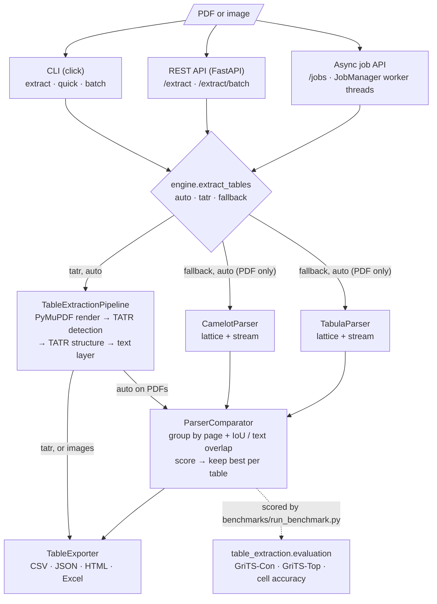

# Table Extraction Pro

Extract tables from PDFs (and table structure from images) into CSV, JSON,
HTML or Excel. A learned detector (Microsoft's Table Transformer, TATR) and
two rule-based parsers (Camelot, Tabula) run behind one interface; when more
than one is installed, their candidates are compared per table and the best
copy is kept.

## The problem

Tables in PDFs are drawn, not stored. A PDF page holds positioned glyphs and
line segments; rows, columns and cells have to be reconstructed. Each
approach fails differently:

- Rule-based parsers are fast and exact when their assumptions hold. Camelot
  `lattice` and Tabula `lattice` need ruling lines and return nothing for an
  unruled table; `stream` modes infer columns from whitespace and often sweep
  captions or nearby prose into the table.
- A learned detector handles layouts without rules, but its geometry is
  approximate and it needs a text source to fill cells.

Running several backends and choosing per table covers more documents than
any single one, provided the choice is measurable. That is what the
evaluation and benchmark parts of this repository are for.

## Architecture



Every entry point goes through `engine.extract_tables`, so the CLI, the
synchronous endpoints and the async job API share one code path. The `auto`
engine sends TATR output and the Camelot and Tabula candidates to
`ParserComparator`, which keeps one copy per table; images go through TATR
only. The evaluation module is not part of extraction: the benchmark uses it
to score each backend against the fixture ground truth.

Package layout:

| Module | Role |
|---|---|
| `table_extraction/models/` | TATR detection and structure wrappers (transformers) |
| `table_extraction/extraction/` | page rendering, text layer, TATR pipeline |
| `table_extraction/parsers/` | Camelot / Tabula wrappers and `ParserComparator` |
| `table_extraction/engine.py` | `auto` / `tatr` / `fallback` engine selection shared by CLI and API |
| `table_extraction/evaluation/` | GriTS-Con, GriTS-Top, strict cell accuracy |
| `table_extraction/export/` | CSV, JSON, HTML, Excel writers |
| `table_extraction/cli/`, `api/` | entry points |

## How detection, fallback and comparison work

**TATR.** Each PDF page is rendered with PyMuPDF. The detection model returns
table boxes; each box is cropped with a 15 pt margin (a tight crop makes the
structure model drop the outer rows and columns) and passed to the structure
model, which returns row, column and header boxes. Rows intersected with
columns give the cell grid. For PDFs, every text-layer word is assigned to
the cell containing its center, after mapping crop pixels back to PDF points.
Image input gets structure only: OCR is not implemented, so cells are empty
and marked `text_source: "none"`.

**Fallbacks.** Camelot runs with both flavors and Tabula with both modes.
Tabula is called page by page because its output does not say which page a
table came from. All cells are normalized to strings, empty rows and columns
are dropped, and every table records its bounding box in PDF points
(top-left origin) so tables from different parsers can be matched.

**Comparison.** `ParserComparator` groups candidates that describe the same
table (same page, and either bbox IoU >= 0.5 or at least 60% shared cell
text), then scores each one:

```
0.20 * parser confidence
0.35 * completeness   share of non-empty cells
0.35 * consistency    share of rows filling at least half of the columns
0.05 * size
0.05 * parser preference (TATR > Camelot > Tabula), mostly a tie-breaker
```

The consistency term is what rejects a `stream` result that absorbed a title
line above the table. The winning table records the candidate parsers and its
score in `metadata`. The weights are hand-set and were checked only against
the fixtures in this repository. They are not tuned on a real corpus.

**Engines.** `tatr` runs TATR only, `fallback` runs the comparator over
Camelot and Tabula, and `auto` (the default) runs everything installed and
compares all candidates together. If a needed extra is missing, you get an
error naming the `pip install` command.

## Install

Python 3.10 or newer.

```bash
pip install -e .                    # base: CLI, API, exporters, evaluation (no torch, no Java)
pip install -e ".[fallback]"        # + Camelot and Tabula (Tabula needs a Java runtime)
pip install -e ".[ml]"              # + torch, transformers, timm for TATR
pip install -e ".[ml,fallback,dev]" # everything, plus test tooling
```

The TATR weights (`microsoft/table-transformer-detection` and
`-structure-recognition`, about 230 MB together) are downloaded from the
Hugging Face Hub on first use and cached under `HF_HOME`.

Check what is available:

```bash
table-extract backends
```

## CLI

```bash
# Default engine (auto), CSV + JSON into out/
table-extract extract -i report.pdf -o out/

# Rule-based parsers only, with metadata, HTML and Excel too
table-extract extract -i report.pdf -o out/ -e fallback -f csv -f html -f excel --include-metadata

# One output file
table-extract quick -i report.pdf -o out/report.xlsx -f excel

# Every PDF/image in a folder, plus out/extraction_summary.json
table-extract batch -i docs/ -o out/ -e auto
```

When a document has several tables, CSV output goes to a directory named
after the input (`out/report/table_1_page_1.csv`, ...). JSON, HTML and Excel
hold all tables in one file.

## API

```bash
table-extract serve --port 8000            # or: docker compose up --build
```

```bash
curl -s localhost:8000/healthz
# {"status":"ok","version":"0.2.0","backends":{"tatr":false,"camelot":true,"tabula":true}}

curl -s -F "file=@report.pdf;type=application/pdf" -F engine=fallback \
     -F include_metadata=false localhost:8000/extract
# {"filename":"report.pdf","engine":"fallback","total_tables":1,"format":"json",
#  "tables":[{"table_id":1,"page_number":1,"data":[["Item","Qty",...],...]}]}
```

| Endpoint | Description |
|---|---|
| `GET /healthz` | liveness, version, installed backends |
| `POST /extract` | multipart `file`; form fields `engine`, `confidence`, `output_format` (`json`, `csv`, `html`), `include_metadata` (default `true`), `use_fallback` (default `false`) |
| `POST /extract/batch` | multipart `files` (up to `TEP_MAX_BATCH_FILES`); per-file results or errors |
| `POST /jobs` | same upload and form fields as `/extract`; returns 202 with a job id and status URL |
| `GET /jobs/{id}` | status (`queued`, `running`, `succeeded`, `failed`), progress, timestamps, error |
| `GET /jobs/{id}/result` | `?format=json\|csv\|html\|xlsx` (default: the submitted `output_format`); 409 until the job succeeded |
| `DELETE /jobs/{id}` | cancel a queued job, cancel a running one (output discarded), or delete a finished one |

Request handling:

- The request body limit (`TEP_MAX_UPLOAD_MB`, default 20) is enforced
  before multipart parsing, from `Content-Length` and by counting chunked
  bodies. Oversized requests get a 413.
- The file extension, declared content type and magic bytes must agree
  (PDF, PNG, JPEG, TIFF, BMP). A mismatch gets a 415 and an empty file a 400.
- Each request writes to its own temporary directory, which is removed on
  success and on failure.
- All errors use the same shape:
  `{"error": {"code": "...", "message": "...", "details": ...}}`. A missing
  backend returns 503 `backend_unavailable` with the extra to install.
- Boolean form fields (`include_metadata`, `use_fallback`) accept
  `true`/`false`, `1`/`0`, `yes`/`no` and `on`/`off`, case-insensitive. An
  omitted or empty field takes the default; anything else is a 422
  `validation_error`.
- CORS is off unless `TEP_CORS_ORIGINS` is set. `TEP_DEFAULT_ENGINE` selects
  the engine used when a request does not specify one.

### Async jobs

For large documents, submit a job instead of holding a request open. The
upload is validated exactly like `/extract` (same 400/413/415 errors) before
the job is accepted. A real session against the fallback engine with the
two-page fixture PDF (`tests/fixtures/generate.py`, saved as `report.pdf`):

```bash
curl -s -i -F "file=@report.pdf;type=application/pdf" -F engine=fallback \
     -F include_metadata=false localhost:8000/jobs
# HTTP/1.1 202 Accepted
# location: /jobs/b0d18126542c4ec7accdc2dd40002e3e
# {"id":"b0d18126542c4ec7accdc2dd40002e3e","status":"queued","filename":"report.pdf","engine":"fallback",
#  "progress":{"pages_done":0,"pages_total":null},"total_tables":null,"created_at":"2026-10-19T11:16:05.731286Z",
#  "started_at":null,"finished_at":null,"expires_at":null,"cancel_requested":false,"error":null,
#  "status_url":"/jobs/b0d18126542c4ec7accdc2dd40002e3e","result_url":null}

curl -s localhost:8000/jobs/$ID/result
# {"error":{"code":"job_not_ready","message":"Job is running","details":{"status":"running"}}}   (HTTP 409)

curl -s localhost:8000/jobs/$ID
# {"id":"b0d1...","status":"succeeded",...,"progress":{"pages_done":2,"pages_total":2},"total_tables":2,
#  "started_at":"2026-10-19T11:16:05.731894Z","finished_at":"2026-10-19T11:16:08.262122Z",
#  "expires_at":"2026-10-19T11:26:08.262122Z",...,"result_url":"/jobs/b0d1.../result"}

curl -s "localhost:8000/jobs/$ID/result?format=json"
# {"filename":"report.pdf","engine":"fallback","total_tables":2,"format":"json",
#  "tables":[{"table_id":1,"page_number":1,"data":[["SKU","Description","On hand","Reorder"],...]},...]}

curl -s "localhost:8000/jobs/$ID/result?format=csv" -o tables.zip   # several tables: zip of CSVs
curl -s "localhost:8000/jobs/$ID/result?format=csv&table_id=1"      # one table as text/csv
# SKU,Description,On hand,Reorder
# A-100,Bolt M6,520,200
# ...
curl -s "localhost:8000/jobs/$ID/result?format=xlsx" -o report.xlsx
curl -s "localhost:8000/jobs/$ID/result?format=html" -o report.html

curl -s -X DELETE localhost:8000/jobs/$ID
# {"id":"b0d18126542c4ec7accdc2dd40002e3e","result":"deleted"}
```

With `TEP_JOB_MAX_QUEUED=1`, a third submission while one job runs and one
waits gets `429 {"error":{"code":"queue_full",...,"details":{"max_queued":1}}}`
with `Retry-After: 5`. Deleting the waiting job returns `"result":"cancelled"`;
deleting the running one returns 202 `"result":"cancel_requested"`, and the
job disappears (404) once its extraction returns.

How jobs work:

- `TEP_JOB_WORKERS` (default 1) threads in the API process run jobs. At most
  `TEP_JOB_MAX_QUEUED` (default 16) jobs may wait for a worker; beyond that
  `POST /jobs` returns 429. Running jobs do not count against the limit.
  The default of one worker is deliberate: all jobs share one pipeline
  instance, and extraction is CPU-bound.
- Each job gets its own temporary directory under `TEP_JOBS_DIR` (default:
  the system temp dir). It holds the upload until extraction finishes, then
  `tables.json`. CSV, HTML and Excel outputs are rendered from it per
  request. Job metadata (status, timestamps, errors) is kept in memory.
- Finished jobs expire `TEP_JOB_TTL_SECONDS` (default 3600) after they
  finish. A janitor thread removes expired jobs every
  `TEP_JOB_CLEANUP_INTERVAL` seconds (default 60), and an expired job is
  already 404 before the sweep runs.
- Files are always removed: the upload as soon as extraction returns, the
  whole directory on failure (only the error record stays until expiry), on
  cancellation, on delete, on expiry, and for every job on shutdown. A
  rejected submission (invalid upload, full queue) writes nothing.
- Progress is coarse: `pages_total` is the PDF page count (1 for an image)
  once the job starts, and `pages_done` jumps to it on success. The engines
  have no per-page callback yet.
- A running extraction cannot be interrupted. Cancelling it discards its
  output and files when it returns; until then it still occupies a worker.
- Worker threads start on the first submission, so the sync endpoints and
  imports start none.

**Jobs are per-process.** They are lost when the process restarts, and they
are not shared between replicas: a status poll that lands on another replica
gets a 404. Run a single API process (one uvicorn worker, one container) if
you use `/jobs`, or route each client to the same instance.

A Redis/RQ-backed version would change:

- Job state in Redis instead of a dict, so any replica can answer status and
  delete requests and jobs survive an API restart; RQ's job status and
  `result_ttl`/`failure_ttl` would replace the TTL and janitor code.
- Extraction in separate RQ worker processes, scaled independently of the
  API, with real cancellation (`send_stop_job_command`) of running jobs.
- Uploads and results on shared storage (an object store or a shared
  volume) instead of a local temp dir, with expiry handled by a lifecycle
  rule or by the worker; the queue limit becomes a check on queue length.
- One more service to run and monitor, which is why this version avoids it.

## Docker

```bash
docker build -t table-extraction-pro .                                  # fallback extra (default)
docker build --build-arg EXTRAS=ml,fallback -t table-extraction-pro:ml .  # adds CPU-only torch + TATR
docker build --build-arg EXTRAS= -t table-extraction-pro:base .           # base install only
TEP_EXTRAS=ml,fallback TEP_EXTRAS_TAG=ml docker compose up --build
```

The build is multi-stage: a builder venv is copied onto `python:3.12-slim`,
the app runs as a non-root user, and a Java runtime is installed only with
the fallback extra. The compose file runs with a read-only root filesystem,
a tmpfs `/tmp`, and a volume for the model cache. Local image sizes
(linux/arm64) were 400 MB for base, 744 MB for fallback and 1.68 GB for
ml,fallback.

## Evaluation and benchmark

`table_extraction.evaluation` implements GriTS (Smock et al., 2022) using the
factored 2D most-similar-substructure method: rows and columns are aligned by
dynamic programming, and cells are rewarded by normalized LCS on their text
(GriTS-Con). GriTS-Top is included for grids without spanning cells.
GriTS-Loc is not implemented. `cell_accuracy` is a stricter, position-wise
exact match with no alignment, so one inserted caption row zeroes it.

`benchmarks/run_benchmark.py` renders the fixture PDFs from
`tests/fixtures/generate.py`: a ruled invoice, an unruled quarterly table,
two ruled tables on one page, and a two-page document. That is 6 tables over
5 pages. The script runs every installed backend, matches each ground-truth
table to the best prediction on its page, and writes a markdown report.

One local run (macOS arm64, CPU only, Python 3.12.11, camelot-py 2.0.0,
tabula-py 2.10.0 with OpenJDK 24, torch 2.14.1, transformers 5.20.1; all
backends were available):

| Backend | Tables found | Extra | GriTS-Con | Cell acc. | Exact | s/page |
|---|---|---|---|---|---|---|
| camelot (lattice) | 5/6 | 0 | 0.833 | 0.833 | 5/6 | 0.269 |
| camelot (stream) | 6/6 | 0 | 0.911 | 0.174 | 1/6 | 0.007 |
| tabula (lattice) | 5/6 | 0 | 0.833 | 0.833 | 5/6 | 0.257 |
| tabula (stream) | 6/6 | 0 | 1.000 | 1.000 | 6/6 | 0.742 |
| fallback (comparator) | 6/6 | 0 | 1.000 | 1.000 | 6/6 | 1.165 |
| tatr | 6/6 | 0 | 1.000 | 1.000 | 6/6 | 0.276 |
| auto (tatr + fallback) | 6/6 | 0 | 1.000 | 1.000 | 6/6 | 1.487 |

Full output, including per-fixture numbers: [benchmarks/results.md](benchmarks/results.md).

How to read these numbers:

- The fixtures are synthetic and clean: born-digital PDFs with a perfect text
  layer, no merged cells and no scans. They show that the pipeline and the
  selection logic work, and how the backends fail (lattice modes miss the
  unruled table; Camelot stream keeps the caption lines). They say nothing
  about accuracy on real documents.
- Times are wall clock on one laptop, as the median of 3 runs after an untimed
  warm-up. Tabula runs through a JVM subprocess per page, which dominates its
  time; installing `jpype1` would avoid that. The comparator and `auto` rows
  include every backend they run.
- Before the TATR crop-margin fix in this repository, the same TATR run
  scored between 0.48 and 0.91 GriTS-Con per table.

Reproduce:

```bash
python benchmarks/run_benchmark.py --repeat 3 --out benchmarks/results.md   # --no-tatr to skip TATR
```

## Development

```bash
uv venv .venv --python 3.12
uv pip install --python .venv/bin/python -e ".[fallback,dev]"
.venv/bin/pytest -q              # fast suite; Camelot/Tabula tests skip if not installed
.venv/bin/pytest -q -m ml        # real TATR models (needs [ml], downloads weights)
.venv/bin/ruff check . && .venv/bin/ruff format --check .
```

The tests generate their fixture PDFs with reportlab at session start and
compare against the golden CSVs in `tests/fixtures/golden/`. The TATR
pipeline is tested without torch through `tests/tatr_fakes.py`, which reads
the ruling lines of the fixture PDFs and answers detection and structure
queries in the same format as the model wrappers. CI
(`.github/workflows/ci.yml`) runs ruff, then the fast suite on Python 3.12
with the fallback parsers (pinned via `requirements/ci-constraints.txt`) and
on Python 3.10 with the base install.

## Limitations

- No OCR. Scanned PDFs and images get table structure but empty cells.
- Spanning (merged) cells are not reconstructed. TATR spanning-cell
  predictions are returned in `structure` but not applied to the grid.
- The fallback parsers read PDFs only.
- The comparator weights and thresholds are heuristics, validated only on the
  fixture set.
- Benchmark coverage is 6 synthetic tables. There is no evaluation on a
  public dataset such as PubTables-1M or FinTabNet yet.
- `/extract` runs extraction synchronously in a worker thread per request.
  `/jobs` frees the request, but its queue lives in the API process: jobs are
  lost on restart, not shared across replicas, and a running extraction
  cannot be stopped mid-way. Job progress is not reported per page.
- TATR runs on CPU unless CUDA is available. GPU paths are untested.

## Roadmap

- OCR backend (Tesseract or PaddleOCR) for images and scanned pages.
- Apply TATR spanning-cell predictions and evaluate them with full GriTS-Top
  and GriTS-Loc.
- Benchmark on a public dataset subset, then tune the comparator weights on
  it instead of setting them by hand.
- Optional Redis/RQ backend for `/jobs` (shared state across replicas,
  separate worker processes, cancellation of running jobs).
- Per-page progress callbacks from the engines for job status.
- Optional `jpype1` integration to keep Tabula's JVM in-process.

## License

MIT, see [LICENSE](LICENSE).
